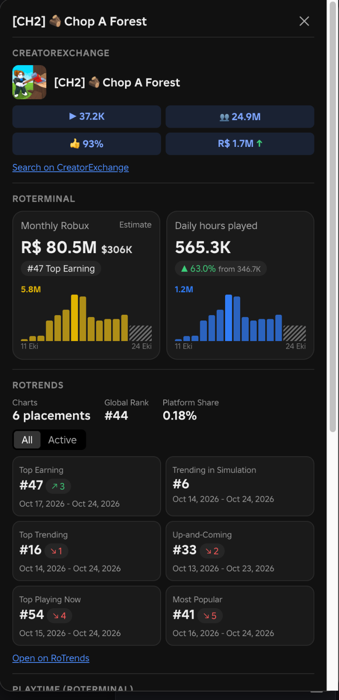

# Roblox Game Stats

A Chrome extension that adds a **📊 Stats** button to every Roblox game page. Click it and a side panel shows the game's analytics from three sites at once: [CreatorExchange](https://creatorexchange.io), [RoTerminal](https://roterminal.co) and [RoTrends](https://www.rotrends.com). No more opening three tabs to size up a game.

## What it shows

| Section | Source | Data |
| --- | --- | --- |
| CreatorExchange | creatorexchange.io | Players now, total visits, like ratio, revenue estimate |
| RoTerminal | roterminal.co | Monthly Robux estimate with Top Earning rank, daily hours played, 14-day bar charts |
| RoTrends | rotrends.com | Chart placements, global rank, platform share, chart cards (All / Active) |
| Playtime | roterminal.co | Minutes per visit (rolling 24h), 1D / 1W / All, hover for any point |
| CCU | roterminal.co | Concurrent players, 1D / 1W / All, hover for any point |

## Install

1. Download this repository (**Code → Download ZIP**) and unzip it, or `git clone` it.
2. Open `chrome://extensions` in Chrome.
3. Turn on **Developer mode** (top right).
4. Click **Load unpacked** and select the extension folder (the one containing `manifest.json`).
5. Open any Roblox game page, for example `https://www.roblox.com/games/...`, and click **📊 Stats** under the Play button.

To update after pulling new code, click the reload icon on the extension's card in `chrome://extensions`, then refresh the Roblox page.

## Notes

- **Monthly Robux** is only shown by RoTerminal to signed-in users. Sign in to roterminal.co in the same Chrome profile to see it; otherwise the tile asks you to sign in.
- RoTerminal runs a browser check. If a direct request is blocked, the extension briefly opens RoTerminal in a background tab, reads the data there and closes the tab.
- RoTrends data is read from its server-rendered HTML, so a redesign of that site can break the RoTrends section.
- Revenue and Robux figures are each site's own estimates, not real earnings, and the sites often disagree.
- Data is fetched fresh every time you open the panel; nothing is cached or sent anywhere else.
- Dates follow your browser's language.

## How it works

- `content.js` runs on `roblox.com/games/*` pages. It reads the universe ID from the page, adds the button and renders the panel inside a shadow root so Roblox's CSS can't affect it.
- `background.js` is the service worker that fetches from the three sites (content scripts can't make cross-origin requests in Manifest V3).

## Disclaimer

This is an unofficial tool. It is not affiliated with Roblox, CreatorExchange, RoTerminal or RoTrends. It relies on their public pages and endpoints, which can change at any time.
